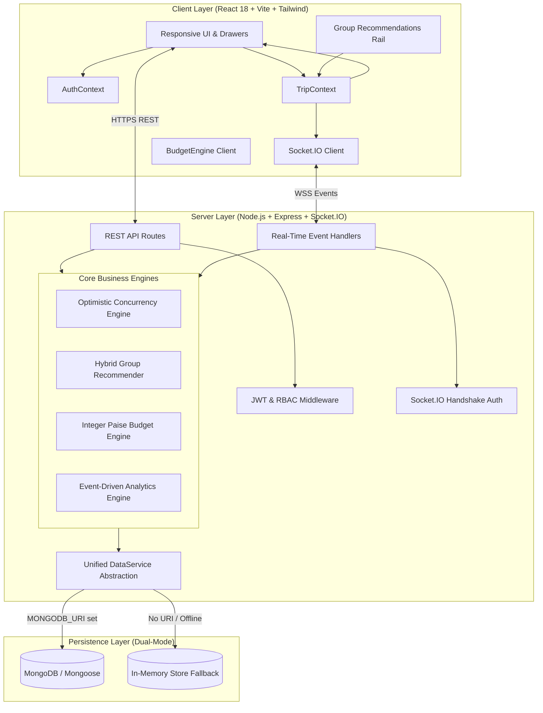
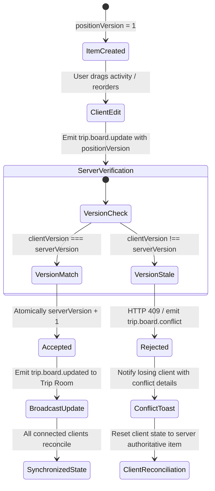
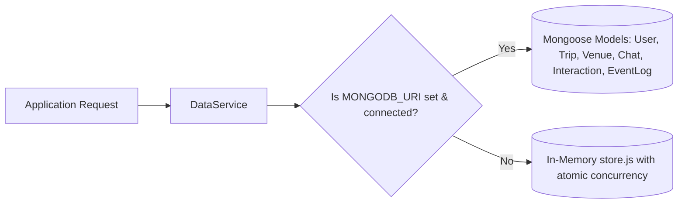

# TripTandem — Architecture & System Design Document

## 1. System Overview

**TripTandem** is a full-stack real-time collaborative travel-planning platform designed to eliminate friction in group itineraries, budget allocation, consensus decision-making, and personalized discovery.

---

## 2. Component Responsibilities

### 2.1 Frontend Client
- **`TripContext.jsx`:** The authoritative state container for the active trip workspace. Subscribes to Socket.IO room events, handles optimistic UI updates, dispatches reconciliation on 409 conflicts, and synchronizes drag-and-drop operations.
- **`AuthContext.jsx`:** Manages user identity, JWT access tokens in memory, token refresh interception, and currency formatting (`₹`).
- **`ItineraryView.jsx` & `ActivityCard.jsx`:** Interactive drag-and-drop itinerary board with clear drag handles, drop zones, insertion indicators, touch/pointer event support, and keyboard navigation.
- **`BudgetDashboard.jsx` & `budgetEngine.js`:** Real-time expense breakdown with equal and custom weighted splits, multi-traveler participant selection, integer paise arithmetic, and minimum cash flow settlement transactions.
- **`GroupRecommendationsRail.jsx`:** Visual recommendation rail presenting group-tailored venues with match percentages and human-readable explanation snippets.
- **`SessionAnalyticsModal.jsx`:** Renders live event-driven collaboration metrics and zero-sum per-person budget reconciliation.

### 2.2 Backend Server
- **`middleware/auth.js`:** Express middleware verifying JWT access token signatures, 1-hour expiration claims, role permissions (`requireRole`), and trip room membership (`requireTripMember`).
- **`socket.js`:** Socket.IO server enforcing connection handshake authentication (`io.use`), room isolation (`socket.join(tripId)`), and event-level RBAC authorization before mutative actions.
- **`services/budgetService.js`:** Mathematical engine executing integer paise arithmetic for equal and weighted splits, ensuring $\sum \text{netBalances} \equiv 0$, and running bipartite minimum cash flow settlement optimization.
- **`services/recommendationService.js`:** Hybrid recommender combining content-based attributes, collaborative travel history, and hard constraints (budget ceilings, dietary tags, deduplication of already pinned venues).
- **`services/analyticsService.js`:** Aggregates real event logs (`EventLog`) to derive active planning days, member participation percentages, peak planning hours, AI inquiries, and resolved conflicts without mock metrics.
- **`services/dataService.js`:** Repository abstraction managing data persistence across MongoDB Mongoose collections and the in-memory fallback store with identical transactional interfaces.

---

## 3. RBAC Enforcement Boundaries

TripTandem supports four well-defined roles across all operations:

| Capability | Viewer | Planner | Leader | Admin |
|---|:---:|:---:|:---:|:---:|
| View Board, Itinerary & Budget | ✅ | ✅ | ✅ | ✅ |
| Participate in Group Voting & Chat | ✅ | ✅ | ✅ | ✅ |
| Pin Activities & Reorder Board | ❌ | ✅ | ✅ | ✅ |
| Create & Log Shared Expenses | ❌ | ✅ | ✅ | ✅ |
| Lock/Unlock Trip Workspace | ❌ | ❌ | ✅ | ✅ |
| Resolve Contested Duels / Overrides | ❌ | ❌ | ✅ | ✅ |
| Change Member Roles / Transfer Lead | ❌ | ❌ | ✅ | ✅ |
| Ingest & Overwrite Venue Datasets | ❌ | ❌ | ❌ | ✅ |

### Enforcement Mechanisms:
1. **REST API Routes:** Protected via `authenticateToken`, `requireRole('Planner'|'Leader'|'Admin')`, and `requireTripMember`. Untrusted request-body user IDs are ignored in favor of verified claims from `req.user`.
2. **WebSocket Events:** Handshake requires verified JWT. Every mutative event (`trip.board.update`, `lock_trip`, `itinerary_change`) validates `socket.user.role` before applying mutations or broadcasting changes.

---

## 4. Optimistic Concurrency Control State Machine

To prevent lost updates when multiple users edit or reorder itinerary activities concurrently, TripTandem implements optimistic concurrency using `positionVersion`.

### Concurrency Guarantees:
- **Atomic Incrementation:** The authoritative server version increments by 1 for every accepted mutation.
- **Stale Rejection:** Edits submitted with an older version are rejected with `{ conflict: true, currentServerVersion, authoritativeItem }`. No database records are overwritten.
- **Client Reconciliation:** When a conflict occurs, the client displays a non-intrusive notification explaining that a collaborator updated the activity, and seamlessly reconciles its local state to the server's authoritative version.

---

## 5. Real-Time Synchronization & Drift Management

1. **Room Isolation:** Clients join a trip room `socket.join(tripId)` upon loading the workspace. Events are scoped exclusively to collaborators within that specific trip.
2. **Sync Drift KPI:** Latency between client emission and collaborator reception is continuously monitored via ping/pong roundtrips (`syncDriftMs < 100ms`).
3. **Leader Disconnect & Role Handover:** If the `Leader` client disconnects, a banner alerts remaining collaborators. Mutations requiring leadership (e.g. room locking) freeze until reconnection or until a handover event transfers the leadership role to a co-Planner.

---

## 6. Persistence Architecture (Dual-Mode)

TripTandem is architected for zero-configuration developer onboarding while supporting production enterprise deployments:

- When `MONGODB_URI` is provided, Mongoose models persist data to MongoDB with compound indexes, unique constraints, and geospatial 2dsphere indexing for venues.
- When running without MongoDB, `dataService.js` routes operations to `store.js`, maintaining exact functional parity, atomic version checking, and event-log querying.

