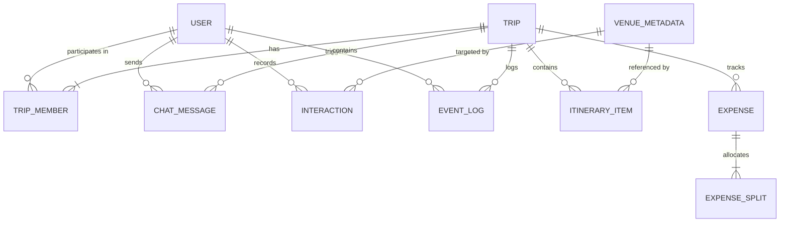

# TripTandem — Database Schema & Data Models Specification

## Overview

TripTandem supports a dual-mode persistence architecture:
1. **Production Mode (MongoDB & Mongoose):** Activated when `MONGODB_URI` is supplied in the environment. All entities are stored with strict schema validations, compound indexes, and 2dsphere geospatial indexing.
2. **In-Memory Fallback Mode (`store.js`):** Activated automatically when `MONGODB_URI` is omitted or disconnected. All CRUD operations, optimistic concurrency checks, and event queries maintain strict behavioral parity through `dataService.js`.

---

## Entity-Relationship (ER) Architecture



---

## 1. User Entity (`User.js`)

Represents travelers, collaborators, and administrators across the platform.

```javascript
// server/src/models/User.js
const userSchema = new mongoose.Schema({
  id: { type: String, required: true, unique: true, index: true },
  name: { type: String, required: true, trim: true },
  email: { type: String, required: true, unique: true, lowercase: true, index: true },
  phone: { type: String, default: '' },
  role: { 
    type: String, 
    enum: ['Viewer', 'Planner', 'Leader', 'Admin'], 
    default: 'Planner' 
  },
  avatar: { type: String, default: 'https://images.unsplash.com/photo-1534528741775-53994a69daeb?w=150&auto=format&fit=crop&q=80' },
  color: { type: String, default: '#FF6B45' },
  upiId: { type: String, trim: true, default: '' },
  upiQrCode: { type: String, default: '' },
  emergencyContact: {
    name: { type: String, default: '' },
    relationship: { type: String, default: '' },
    phone: { type: String, default: '' },
    bloodGroup: { type: String, default: '' },
    medicalNotes: { type: String, default: '' }
  },
  refreshTokens: [
    {
      token: { type: String, required: true },
      expiresAt: { type: Date, required: true },
      createdAt: { type: Date, default: Date.now }
    }
  ]
}, { timestamps: true });
```

### Validation & Indexing
- `email`: Indexed, unique, lowercase trimmed string.
- `id`: Custom primary UUID/slug, unique index.
- `refreshTokens.token`: Stored for session validation and invalidated on token rotation or logout.

---

## 2. Trip Entity (`Trip.js`)

Central workspace document representing a collaborative travel itinerary, members, and budget.

```javascript
// server/src/models/Trip.js
const tripSchema = new mongoose.Schema({
  id: { type: String, required: true, unique: true, index: true },
  title: { type: String, required: true, trim: true },
  destination: { type: String, required: true },
  inviteCode: { type: String, required: true, unique: true, index: true },
  coverImage: { type: String, default: '' },
  startDate: { type: String, required: true },
  endDate: { type: String, required: true },
  daysCount: { type: Number, required: true, min: 1 },
  isRoomLocked: { type: Boolean, default: false },
  members: [
    {
      id: { type: String, required: true },
      name: { type: String, required: true },
      role: { type: String, enum: ['Viewer', 'Planner', 'Leader', 'Admin'], default: 'Planner' },
      avatar: { type: String },
      color: { type: String },
      upiId: { type: String }
    }
  ],
  budget: {
    totalTarget: { type: Number, default: 40000, min: 0 },
    splitMode: { type: String, enum: ['equal', 'weighted'], default: 'equal' },
    categories: {
      accommodation: { type: Number, default: 0 },
      food: { type: Number, default: 0 },
      activities: { type: Number, default: 0 },
      transport: { type: Number, default: 0 }
    },
    expenses: [
      {
        id: { type: String, required: true },
        title: { type: String, required: true },
        amount: { type: Number, required: true, min: 0 },
        paidBy: { type: String, required: true },
        splitMode: { type: String, enum: ['equal', 'weighted'], default: 'equal' },
        splitWith: [{ type: String, required: true }],
        splits: { type: Map, of: Number, default: () => ({}) },
        category: { type: String, default: 'activities' },
        date: { type: String, default: () => new Date().toISOString() }
      }
    ]
  },
  days: [
    {
      dayNumber: { type: Number, required: true },
      dateFormatted: { type: String },
      theme: { type: String, default: '' },
      items: [itineraryItemSchema]
    }
  ]
}, { timestamps: true });
```

---

## 3. ItineraryItem Entity (`ItineraryItem.js`)

Activities scheduled on the real-time board. Enforces optimistic concurrency via `positionVersion` and the three-stage lifecycle state machine.

```javascript
// server/src/models/ItineraryItem.js
const itineraryItemSchema = new mongoose.Schema({
  id: { type: String, required: true },
  dayNumber: { type: Number, required: true },
  timeSlot: { 
    type: String, 
    enum: ['morning', 'afternoon', 'evening', 'night'], 
    default: 'afternoon' 
  },
  startTime: { type: String, default: '10:00 AM' },
  duration: { type: String, default: '2h' },
  title: { type: String, required: true, trim: true },
  venueId: { type: String, default: null },
  venueName: { type: String, default: '' },
  category: { 
    type: String, 
    enum: ['experience', 'restaurant', 'stay', 'transit'], 
    default: 'experience' 
  },
  image: { type: String },
  costPerPerson: { type: Number, default: 0, min: 0 },
  location: { type: String, default: '' },
  source: { type: String, enum: ['user', 'ai', 'curated'], default: 'user' },
  notes: { type: String, default: '' },
  order: { type: Number, default: 0 },
  
  // Optimistic concurrency control
  positionVersion: { type: Number, default: 1, min: 1 },
  
  // Collaborative lifecycle progression
  lifecycleStage: { 
    type: String, 
    enum: ['drafting', 'voting', 'locked'], 
    default: 'drafting' 
  },
  
  votes: {
    up: [{ type: String }],
    down: [{ type: String }]
  }
}, { timestamps: true });
```

---

## 4. VenueMetadata Entity (`VenueMetadata.js`)

Curated places, stays, dining, and activities with geospatial 2dsphere indexing and dietary classification.

```javascript
// server/src/models/VenueMetadata.js
const venueMetadataSchema = new mongoose.Schema({
  id: { type: String, required: true, unique: true, index: true },
  name: { type: String, required: true, trim: true },
  destination: { type: String, required: true, index: true },
  region: { type: String, default: '' },
  state: { type: String, default: '' },
  category: { 
    type: String, 
    enum: ['restaurant', 'experience', 'stay', 'popular'], 
    required: true, 
    index: true 
  },
  type: { type: String, default: 'experience' },
  price: { type: Number, required: true, min: 0, index: true },
  rating: { type: Number, default: 4.5, min: 0, max: 5 },
  reviewCount: { type: Number, default: 0, min: 0 },
  openingHours: { type: String, default: '09:00 AM - 10:00 PM' },
  dietaryTags: [{ type: String, lowercase: true }],
  amenities: [{ type: String }],
  description: { type: String, default: '' },
  badge: { type: String, default: '' },
  images: [{ type: String }],
  
  // Geospatial indexing
  location: {
    type: { 
      type: String, 
      enum: ['Point'], 
      default: 'Point' 
    },
    coordinates: { 
      type: [Number], // [longitude, latitude]
      required: true 
    }
  }
}, { timestamps: true });

venueMetadataSchema.index({ location: '2dsphere' });
venueMetadataSchema.index({ destination: 1, category: 1, price: 1 });
```

---

## 5. ChatMessage Entity (`ChatMessage.js`)

Real-time collaborative chat messages with AI Concierge grounding and emoji reactions.

```javascript
// server/src/models/ChatMessage.js
const chatMessageSchema = new mongoose.Schema({
  id: { type: String, required: true, unique: true, index: true },
  tripId: { type: String, required: true, index: true },
  sender: {
    id: { type: String, required: true },
    name: { type: String, required: true },
    avatar: { type: String }
  },
  text: { type: String, required: true },
  timestamp: { type: String, default: () => new Date().toISOString() },
  isAi: { type: Boolean, default: false },
  groundingSources: [{ type: String }],
  reactions: {
    type: Map,
    of: [{ type: String }], // emoji -> array of userIds
    default: () => ({})
  }
}, { timestamps: true });

chatMessageSchema.index({ tripId: 1, createdAt: 1 });
```

---

## 6. Interaction Entity (`Interaction.js`)

Explicit and implicit traveler interaction events utilized by the hybrid group recommendation engine.

```javascript
// server/src/models/Interaction.js
const interactionSchema = new mongoose.Schema({
  id: { type: String, required: true, unique: true, index: true },
  userId: { type: String, required: true, index: true },
  tripId: { type: String, required: true, index: true },
  venueId: { type: String, required: true, index: true },
  category: { type: String, required: true },
  interactionType: { 
    type: String, 
    enum: ['view', 'pin', 'vote_up', 'vote_down', 'book', 'co_travel'], 
    required: true 
  },
  rating: { type: Number, min: 1, max: 5 },
  coTraveledWith: [{ type: String }],
  timestamp: { type: Date, default: Date.now, index: true }
}, { timestamps: true });

interactionSchema.index({ userId: 1, venueId: 1, interactionType: 1 });
interactionSchema.index({ tripId: 1, timestamp: -1 });
```

---

## 7. EventLog Entity (`EventLog.js`)

Immutable append-only audit trail powering event-driven session analytics.

```javascript
// server/src/models/EventLog.js
const eventLogSchema = new mongoose.Schema({
  id: { type: String, required: true, unique: true, index: true },
  tripId: { type: String, required: true, index: true },
  type: {
    type: String,
    required: true,
    index: true,
    enum: [
      'trip.created',
      'trip.member.joined',
      'trip.member.role_changed',
      'trip.member.removed',
      'itinerary.item.created',
      'itinerary.item.updated',
      'itinerary.item.reordered',
      'itinerary.item.deleted',
      'conflict.flagged',
      'conflict.resolved',
      'ai.question',
      'vote.opened',
      'vote.cast',
      'vote.resolved',
      'budget.expense.created',
      'budget.expense.updated',
      'budget.split_mode_changed',
      'trip.locked',
      'trip.unlocked',
      'trip.leader.transferred'
    ]
  },
  actorId: { type: String, required: true, index: true },
  timestamp: { type: Date, default: Date.now, index: true },
  metadata: { type: mongoose.Schema.Types.Mixed, default: () => ({}) }
}, { timestamps: true });

eventLogSchema.index({ tripId: 1, type: 1 });
eventLogSchema.index({ tripId: 1, timestamp: -1 });
```

