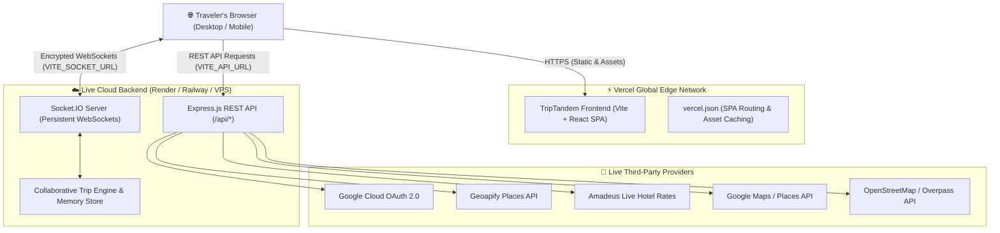

# ✈️ TripTandem — Collaborative Travel Platform

> **“Plan your trip. Find your rhythm.”**  
> A high-aesthetic, production-grade collaborative travel web application combining Airbnb-tier discovery, real-time multi-user synchronization, and grounded AI trip planning.

[](https://vercel.com/)
[](https://github.com/Shashaannkk/TripTandem)
[](https://react.dev/)
[](https://nodejs.org/)

---

## 🌐 Live Production Architecture

TripTandem is architected for modern, high-availability cloud deployment with decoupled frontend delivery and persistent real-time server connections:



- **Frontend on Vercel**: Hosted globally on Vercel's Edge CDN. Handles rapid client-side routing, responsive UI, micro-animations, and offline resilient fallbacks.
- **Backend on Cloud (Render / Railway / VPS)**: Hosts the Express REST API endpoints and stateful Socket.IO engine to enable live collaborator presence, live group chat, and real-time itinerary voting.
- **Data Provider Adapter Hub**: Pluggable architecture that pulls live venue data from Geoapify, Amadeus, Google Places, and OpenStreetMap, with automatic fallback to seed data if API keys are unconfigured.

---

## 🚀 Live Vercel Deployment Guide (Step-by-Step)

Follow this simple guide to deploy the TripTandem frontend directly to Vercel with zero friction:

### Step 1: Push Repository to GitHub
Ensure your repository is pushed to your GitHub account:
```bash
https://github.com/Shashaannkk/TripTandem.git
```

### Step 2: Import Project into Vercel
1. Log in to your [Vercel Dashboard](https://vercel.com/dashboard).
2. Click **Add New...** ➔ **Project**.
3. Select and import the `TripTandem` repository from your GitHub account.

### Step 3: Configure Build & Project Settings
TripTandem includes pre-configured `vercel.json` files at both the root and client levels. Vercel will automatically detect the configuration, but verify these settings:

| Setting | Recommended Value | Notes |
| :--- | :--- | :--- |
| **Framework Preset** | `Vite` | Detected automatically |
| **Root Directory** | `./` (or `client`) | Supported either way |
| **Build Command** | `cd client && npm install && npm run build` | Handled by root `vercel.json` |
| **Output Directory** | `client/dist` (or `dist` if root is `client`) | Handled automatically |
| **Install Command** | `npm install` | Standard |

### Step 4: Configure Live Environment Variables in Vercel
In the Vercel Project Settings under **Environment Variables**, add the following keys for **Production**:

| Variable Name | Required | Example Live Value | Purpose |
| :--- | :---: | :--- | :--- |
| `VITE_API_URL` | **Yes** | `https://your-backend.onrender.com/api` | Directs REST API calls to your live backend server |
| `VITE_SOCKET_URL` | **Yes** | `https://your-backend.onrender.com` | Live WebSocket endpoint for real-time collaboration |
| `VITE_GOOGLE_CLIENT_ID` | Optional | `959503...apps.googleusercontent.com` | Enables live Google OAuth 2.0 One Tap & popup login |
| `VITE_GEOAPIFY_API_KEY` | Optional | `your_geoapify_key` | Enables client-side location autocomplete |
| `VITE_GOOGLE_MAPS_API_KEY`| Optional | `AIzaSy...` | Enables Google Places photos and client geocoding |

### Step 5: Deploy & Verify
1. Click **Deploy**. Vercel will install dependencies and compile the production bundle.
2. Once complete, you will receive your live domain (e.g., `https://triptandem.vercel.app`).
3. Click your live URL and test navigation. Notice that refreshing any deep link (e.g., `/explore`, `/trips`) works seamlessly without 404 errors due to our SPA rewrites rule.

---

## ☁️ Live Backend Deployment Guide (Render / Railway)

Because Socket.IO requires persistent WebSockets for live group collaboration, deploy the server to a persistent Node.js host such as [Render](https://render.com/) or [Railway](https://railway.app/).

### Deploying on Render (Free & Fast)
1. In the [Render Dashboard](https://dashboard.render.com/), click **New +** ➔ **Web Service**.
2. Connect your GitHub repository: `https://github.com/Shashaannkk/TripTandem.git`.
3. Configure service details:
   - **Name**: `triptandem-server`
   - **Region**: Closest to your users (e.g., Singapore, Frankfurt, Oregon)
   - **Branch**: `main`
   - **Root Directory**: `server`
   - **Runtime**: `Node`
   - **Build Command**: `npm install`
   - **Start Command**: `npm start`
4. Add **Environment Variables** in Render:
   ```env
   NODE_ENV=production
   PORT=10000
   JWT_SECRET=your_super_secret_production_key_32_chars
   CLIENT_URL=https://your-triptandem.vercel.app
   GOOGLE_CLIENT_ID=your_google_client_id.apps.googleusercontent.com
   GOOGLE_CLIENT_SECRET=your_google_client_secret
   GEOAPIFY_API_KEY=your_geoapify_key
   AMADEUS_CLIENT_ID=your_amadeus_client_id
   AMADEUS_CLIENT_SECRET=your_amadeus_client_secret
   GOOGLE_MAPS_API_KEY=your_google_maps_key
   ```
5. Click **Create Web Service**.
6. When deployed, your live backend URL will be ready: `https://triptandem-server.onrender.com`.
7. Verify health by visiting:
   ```bash
   curl https://triptandem-server.onrender.com/api/health
   # Returns: {"status":"healthy","platform":"TripTandem Travel API",...}
   ```
8. Paste this URL into your Vercel `VITE_API_URL` and `VITE_SOCKET_URL` variables.

---

## 🔑 Live Google OAuth 2.0 Configuration

TripTandem implements real OpenID Connect Google Authentication. To authorize your live production domains:

1. Open the [Google Cloud Console](https://console.cloud.google.com/apis/credentials).
2. Select your Project and navigate to **APIs & Services** ➔ **Credentials**.
3. Under **OAuth 2.0 Client IDs**, select your Web Client ID (or click **Create Credentials** ➔ **OAuth client ID** ➔ **Web application**).
4. In **Authorized JavaScript origins**, add:
   - `https://your-triptandem.vercel.app` (Your live Vercel production domain)
   - `https://your-custom-domain.com` (If using a custom domain)
   - `http://localhost:5173` (For local development)
5. In **Authorized redirect URIs**, add:
   - `https://your-triptandem.vercel.app`
   - `https://your-triptandem-server.onrender.com/api/auth/google/callback`
6. Click **Save**.
7. Copy your `Client ID` into `VITE_GOOGLE_CLIENT_ID` on Vercel and `GOOGLE_CLIENT_ID` on your server.
8. Copy your `Client Secret` into `GOOGLE_CLIENT_SECRET` on your server.

---

## 🗺️ Live Travel Data Provider Hub

TripTandem includes an intelligent adapter hub designed to operate with high reliability across four providers:

| Provider | Type | API Key Required? | Capabilities |
| :--- | :---: | :---: | :--- |
| **OpenStreetMap / Overpass** | Open API | **No** (Works out of the box) | Global POI discovery (hotels, cafes, attractions, viewpoints) |
| **Geoapify Places** | REST API | Yes (`GEOAPIFY_API_KEY`) | Structured category searches, radial place queries, geocoding |
| **Amadeus for Developers** | REST API | Yes (`AMADEUS_CLIENT_ID`) | Live room rates, verified hotel availability, bookable offers |
| **Google Places API** | REST API | Yes (`GOOGLE_MAPS_API_KEY`)| High-resolution photos, real reviews, place ratings |

> [!NOTE]
> **Graceful Fallback**: If third-party API credentials are not yet entered, the platform seamlessly displays curated verified venue seeds with transparent status indicators (*Verified Live*, *Indicative Rate*, or *Seed Data*), ensuring a clean and reliable traveler experience at all times.

---

## 🛠️ Complete Environment Variables Matrix

### Client (`client/.env` / Vercel Environment Variables)
```env
# Google OAuth 2.0 Public Client ID
VITE_GOOGLE_CLIENT_ID=your_id.apps.googleusercontent.com

# Live Backend REST API Endpoint
VITE_API_URL=https://your-triptandem-server.onrender.com/api

# Live Real-time WebSocket Endpoint
VITE_SOCKET_URL=https://your-triptandem-server.onrender.com

# Optional Third-Party Keys
VITE_GEOAPIFY_API_KEY=your_geoapify_key
VITE_GOOGLE_MAPS_API_KEY=your_google_maps_key
```

### Server (`server/.env` / Render / Railway Environment Variables)
```env
# Server Runtime
PORT=3001
NODE_ENV=production

# Security & Tokens
JWT_SECRET=long_secure_random_string_for_production
CLIENT_URL=https://your-triptandem.vercel.app

# Google Authentication Verification
GOOGLE_CLIENT_ID=your_id.apps.googleusercontent.com
GOOGLE_CLIENT_SECRET=your_client_secret

# Travel Data Adapters
GEOAPIFY_API_KEY=your_geoapify_key
AMADEUS_CLIENT_ID=your_amadeus_client_id
AMADEUS_CLIENT_SECRET=your_amadeus_client_secret
AMADEUS_BASE_URL=https://test.api.amadeus.com
GOOGLE_MAPS_API_KEY=your_google_maps_key
```

---

## 🎨 Design System & Visual Tokens

- **Deep Navy (`#0B2545`)**: Structural text, dark glassmorphism surfaces, solid trust foundation.
- **Sunset Orange (`#FF6B45`)**: High-contrast primary call-to-actions, voting buttons, highlights.
- **Warm Yellow (`#FFC857`)**: Discovery tags, optimistic ratings, celebration cues.
- **Travel Teal (`#2A9D8F`)**: Consensus indicators, locked activity badges, success modals.
- **Sky Blue (`#8EC5E8`)**: Informational chips and subtle glows.
- **Light Sand (`#F9F7F2`)**: Primary warm neutral page background for tactile editorial warmth.
- **Typography**: Google Fonts **Poppins** (`300`, `400`, `500`, `600`, `700`).

---

## ⚡ Core Features & Capabilities

### 1. Collaborative Itinerary Workspace
- **Real-Time Presence**: Live collaborator avatars with real-time glowing online status indicators.
- **Consensus Voting Engine**:
  - Activities transition cleanly from **Drafting** ➔ **Voting** ➔ **Locked**.
  - Real-time upvotes and downvotes with collaborator avatar indicators.
  - Automatic locking and celebration confetti upon reaching **75% consensus**.
- **Conflict Safeguards**:
  - **Time Overlaps**: Flags scheduling clashes with 1-click **Auto-adjust Gap (+30m)**.
  - **Transit Warnings**: Alerts users to excessive cross-city travel times between consecutive activities.
  - **Budget Alerts**: Visual indicators when estimated day totals exceed group targets.

### 2. Group Chat & Room Synchronization
- Powered by persistent Socket.IO rooms.
- Dedicated rooms per trip (`trip_${tripId}`) preventing data leaks across trips.
- In-chat typing indicators and 1-click activity mentions.

### 3. AI Concierge
- Grounded conversational planning assistant.
- Recommends activities and accommodations strictly within the user's budget ceiling and dietary constraints.
- Benchmark prompt chips:
  - *“Plan a three-day Goa trip for four friends under ₹20,000 total.”*
  - *“Find vegetarian restaurants near our afternoon activity.”*
  - *“Rearrange tomorrow to reduce travel time.”*
- Direct **Add to Itinerary as Draft** button.

### 4. Shared Budget & Fair Splits
- Target budget vs Estimated total vs Actual paid expenses.
- Category breakdowns (Accommodation, Food, Transport, Activities, Other) with visual progress meters.
- Equal (25% each) and Custom Weighted expense splitting.
- Individual member balances (*"Who owes whom"* summary matrix).

---

## 📋 Live Verification Checklist

Run through this checklist after deploying live to Vercel and your backend:

- [ ] **SPA Route Refresh**: Open `/explore`, `/trips/trip-goa-001`, or `/planner` and press refresh (F5). Ensure the page reloads cleanly without 404s.
- [ ] **Live API Health Check**: Visit `https://your-backend.onrender.com/api/health` and verify `status: "healthy"`.
- [ ] **Real-Time Presence**: Open the trip workspace in two separate browser windows (or share with a friend). Verify avatars appear in real time.
- [ ] **Consensus Voting**: Cast an upvote in one window; confirm the vote count and avatar update instantaneously in the other window.
- [ ] **Google Sign-In**: Click **Continue with Google**. Verify the real Google account selector opens with your production domain listed.
- [ ] **AI Concierge**: Click the **AI Concierge** floating button and ask for recommendations. Verify fast responses.

---

## 📄 License & Attribution

Developed for seamless group travel planning.  
Built with React, Vite, Express, Socket.IO, and Tailwind CSS.
